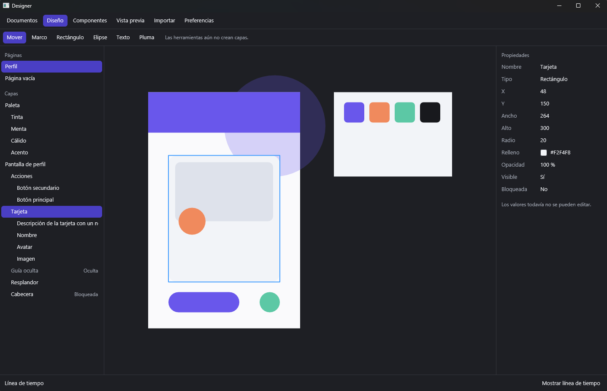

# Designer

An independent, MIT-licensed native design and animation editor being built in
Rust. Windows is the first target. GPUI owns the interface; Vello will render
the vector canvas. Native documents will use **`.dsg`**.

## Project status

**Pre-alpha: basic shape editing and local document files. No release yet.**
The Windows GPUI application composites a Vello canvas through shared GPU
textures. Create documents, draw frames/rectangles/ellipses, select and move
layers, delete, undo/redo, and save/open `.dsg` files. The inspector remains
read-only. Text rendering, pen editing, recovery, animation UI and MCP remain
unimplemented. The timeline is a placeholder.
No 60 FPS result has been established.

The project must finish validating Vello texture composition inside GPUI without
a per-frame CPU readback before expanding the editor; the remaining checks are
listed in [GPU interop](docs/gpu-interop.md). See the
[feature matrix](replica/features.csv) and [build log](replica/build-log.md).

## Documentation

- [Build and verify](docs/build.md)
- [Architecture and graphics gate](replica/architecture.md)
- [Document format specification (draft)](docs/dsg-format.md)
- [Agent integration contract (draft)](docs/mcp.md)
- [Migration from Figma](docs/figma-migration.md)
- [Forking and maintaining a derivative](docs/forking.md)
- [Contributing](CONTRIBUTING.md)
- [Security](SECURITY.md)
- [Roadmap](ROADMAP.md)
- [Third-party notices](THIRD_PARTY_NOTICES.md)

## Product direction

Local vector design, typography, auto layout, components, a keyframe timeline,
path morphing, nested sequences and visual interaction states. The application
will initially use Spanish UI labels; all public documentation is in English.
Agents will use the same transactional commands as the interface, live or
headlessly. There is no developer mode, code generation, cloud collaboration,
or animation export in scope.

Designer is independent of Figma and is not endorsed by it. Original project
code and documentation are [MIT licensed](LICENSE). Dependencies retain their
own licenses. Screenshots are captured from the running application and show
only what it does today.
